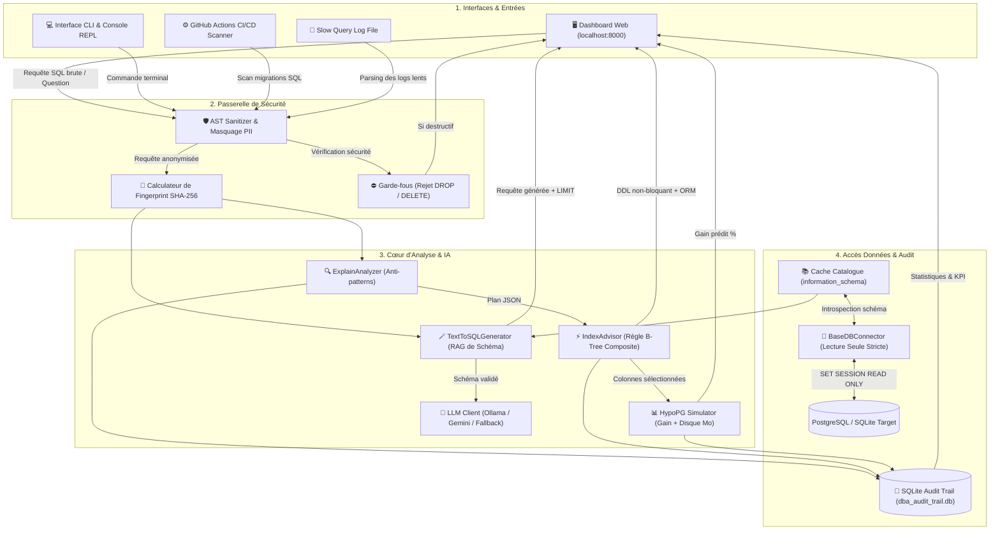
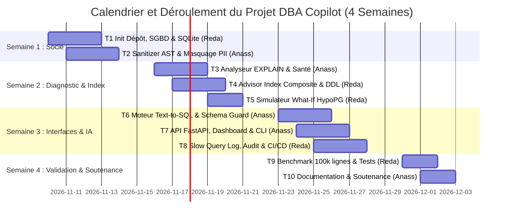

# Dossier de lancement (semaine 1)

Nov 9, 2026 · Équipe DBA Copilot Agent : Anass Lahmar & Reda Saadoune

## Mode d'emploi & Répartition du Binôme

La semaine 1 est décisive : sur un projet de 4 semaines, un cadrage flou ou des données indisponibles ne se rattrapent pas. Ce dossier permet à l'enseignant de valider le cadrage et l'opérationnalité du projet sous 48 heures.

L'équipe est constituée de **2 étudiants** : **Anass Lahmar** et **Reda Saadoune**.

**Notre répartition officielle**

| Livrable | Rédacteur | Relecteur | Fichier dans le dépôt |
| :--- | :--- | :--- | :--- |
| **1. Descriptif du projet** | Anass Lahmar | Reda Saadoune | `docs/semaine1/1-descriptif.md` |
| **2. Dataset & Données** | Reda Saadoune | Anass Lahmar | `docs/semaine1/2-dataset.md` + `data/sample/` |
| **3. Maquette globale & Architecture** | Anass Lahmar | Reda Saadoune | `docs/semaine1/3-maquette.md` + `docs/semaine1/img/` |
| **4. Pipeline des tâches** | Reda Saadoune *(consolidation)* | Anass Lahmar | `docs/semaine1/4-pipeline.md` |

---

## Livrable 1 : Descriptif du projet mis à jour

**Rédacteur** : Anass Lahmar   **Relecteur** : Reda Saadoune   **Fichier** : `docs/semaine1/1-descriptif.md`

### 1.1 Contexte et problème
En production, plus de 70% des dégradations de performance proviennent de requêtes SQL inefficaces provoquant des balayages complets de tables (*Full Table Scan / Seq Scan*), des tris temporaires sur disque (*Sort Spill*) ou des jointures mal indexées. Aujourd'hui, les développeurs manquent d'outils simples pour interpréter les plans d'exécution `EXPLAIN`, et les DBA interviennent en pompier lors des incidents critiques. De plus, créer des index à chaud sans précaution pose des verrous exclusifs (`ShareLock`) qui bloquent les transactions applicatives.

### 1.2 Objectif
Concevoir et déployer un **Agent Intelligent d'Optimisation de Base de Données (DBA Copilot)** capable d'analyser les requêtes lentes et les plans `EXPLAIN`, d'identifier la cause racine des goulots, de recommander des index composites non-bloquants avec simulation mathématique de gain, et de traduire des questions métier en requêtes SQL sécurisées.

### 1.3 Utilisateurs cibles et scénario d'usage principal
- **Utilisateurs cibles** : Développeurs Backend (Python, Node.js, Java, Go), Lead Développeurs, Administrateurs de bases de données (DBA) et Ingénieurs DevOps.
- **Scénario d'usage principal** :
  1. Le développeur (ou le pipeline CI/CD) soumet une requête SQL lente ou un journal de requêtes lentes (*Slow Query Log*).
  2. L'Agent applique un masquage des données sensibles (PII / RGPD) et calcule l'empreinte unique de la requête (*Fingerprint*).
  3. L'Agent examine le plan d'exécution `EXPLAIN`, évalue le score de santé (/100) et explique le problème en clair (ex: *Seq Scan sur 248 000 lignes*).
  4. L'Agent conçoit l'index composite optimal selon la règle de sélectivité B-Tree (Égalités $\rightarrow$ Plages $\rightarrow$ Tris) et fournit le DDL non-bloquant de production (`CONCURRENTLY`) ainsi que les définitions ORM (Django, SQLAlchemy, Prisma).
  5. L'Agent simule mathématiquement le différentiel de coût (gain estimé de +80% à +99%) et calcule l'empreinte disque en Mo avant toute modification physique.
  6. L'opération est consignée dans un journal d'audit persistant pour la gouvernance.

### 1.4 Fonctionnalités du MVP (Équipe de 2 étudiants)

| N° | Fonctionnalité | Ce que l'utilisateur voit ou obtient | Priorité |
| :---: | :--- | :--- | :---: |
| **F1** | **Analyse SQL, Sanitisation PII & Diagnostic EXPLAIN** | Requête SQL sanitisée avec paramètres masqués (`:val_str_1`), Score de Santé (/100), détection des anti-patterns (Seq Scan, Sort Spill, Nested Loops, `SELECT *`) et explication pédagogique sans jargon. | Indispensable |
| **F2** | **Recommandation d'Index Composite & Simulation What-If** | Script DDL non-bloquant de production (`CREATE INDEX CONCURRENTLY IF NOT EXISTS ... INCLUDE (...)`), templates ORM (Django, SQLAlchemy, Prisma) et estimation mathématique du gain de coût et de taille disque (Mo) sans toucher au disque. | Indispensable |
| **F3** | **Assistant Text-to-SQL Sécurisé & Ancré au Schéma** | Traduction d'une question métier en français en requête SQL valide, garantie Zero-Hallucination via validation stricte sur le schéma (`Schema Guard`), clause `LIMIT` obligatoire et mode lecture seule strict. | Indispensable |
| **F4** | **Ingestion Slow Query Log & Traçabilité d'Audit** | Ingestion directe de fichiers de log PostgreSQL/MySQL avec tri des requêtes les plus coûteuses, tableau de bord de gouvernance avec métriques en temps réel et journal d'audit persistant SQLite. | Souhaitable |

### 1.5 Services et composants techniques

| Service ou composant | Rôle dans le projet | Technologie choisie | Pourquoi ce choix |
| :--- | :--- | :--- | :--- |
| **Modèle (LLM local & Cloud)** | Vulgarisation pédagogique et génération Text-to-SQL | Ollama (`qwen2.5-coder:1.5b` / `llama3.2`) + Google Gemini / OpenAI + Fallback Déterministe | Confidentialité totale et exécution 100% hors-ligne gratuite sur CPU local, avec bascule sans crash si hors réseau. |
| **SGBD & Introspection** | Connexion en lecture seule et extraction de schéma | PostgreSQL 16, SQLite 3, `information_schema` | SGBD de référence en entreprise ; SQLite pour les démos légères autonomes. |
| **Moteur d'Audit & Cache** | Parseur AST, calcul de fingerprint, cache TTL | Python standard (`re`, `hashlib`, `sqlite3`) | Aucune dépendance lourde, performance instantanée (< 50 ms par audit). |
| **API REST** | Exposition des endpoints d'analyse et de simulation | FastAPI + Uvicorn | Documentation interactive Swagger OpenAPI native (`/docs`), sérialisation Pydantic v2. |
| **Interface Graphique** | Tableau de bord développeur interactif | HTML5 / Tailwind CSS CDN / Vanilla JS | Interface moderne responsive Dark Mode servie directement par l'API sans outil tiers. |
| **Conteneur & CI/CD** | Déploiement reproductible et scan des PRs | Docker, Docker Compose, GitHub Actions | Standardisation du déploiement et contrôle automatique des migrations SQL en CI. |

### 1.6 Hors périmètre
- Exécution automatique de modifications DDL en écriture directe sur la base de production (l'Agent est en Read-Only strict pour des raisons évidentes de sécurité ; l'application du script DDL reste sous la responsabilité du DBA).
- Administration matérielle et système du cluster SGBD (dimensionnement physique RAM/CPU, gestion du stockage RAID, sauvegardes physiques WAL).

### 1.7 Écart avec la fiche du catalogue
- **Ajout d'un simulateur What-If (HypoPG virtuel)** pour calculer mathématiquement le gain et la taille de l'index sans consommer de disque.
- **Génération multi-ORM** (snippets Django, SQLAlchemy, Prisma) en plus du DDL brut pour s'adapter au flux réel des développeurs.
- **Scanner CI/CD intégré** pour commenter et bloquer automatiquement les Pull Requests contenant des requêtes lentes non indexées.

---

## Livrable 2 : Dataset & Données de Référence

**Rédacteur** : Reda Saadoune   **Relecteur** : Anass Lahmar   **Fichiers** : `docs/semaine1/2-dataset.md` + `data/sample/`

### 2.1 Description

| Rubrique | Réponse |
| :--- | :--- |
| **Nom et source** | Jeu d'évaluation e-commerce synthétique & journal de requêtes lentes réel (`ecommerce_db`, `benchmark_data.db`, `sample_slow_queries.log`). |
| **Producteur ou propriétaire** | Généré de manière déterministe et reproductible par l'équipe via des scripts Python et SQL d'initialisation (`docker/init_db.sql` et `benchmark.py`). |
| **Volume** | **100 000 enregistrements réels** dans la table de benchmark (`transactions`), 1 000 clients et 5 000 commandes dans le schéma PostgreSQL initial. Échantillon de log de 4 requêtes types (< 1 Mo dans Git). |
| **Format et structure** | Base SQLite (`.db`), script d'initialisation SQL DDL (`.sql`), journal texte PostgreSQL (`.log`). Tables clés : `customers`, `orders`, `transactions`, `vouchers`. |
| **Langue et période** | Données et requêtes en français et anglais. Période simulée : 2021 à 2026. |
| **Licence et droits d'usage** | Licence Creative Commons CC0 / Domaine Public (données synthétiques créées pour le projet, sans droits tiers). |
| **Données personnelles & traitement** | **Aucune donnée personnelle réelle**. Noms génériques (`Client 1`, `Dupont`) et adresses e-mails fictives (`user_X@ecommerce.com`). L'Agent intègre de plus un module de masquage PII systématique. |
| **Emplacement des données complètes** | Échantillon léger dans `data/sample/` et `sample_slow_queries.log`. Base complète de 100 000 lignes générée à la volée en 1.1 seconde via `benchmark.py`. |

### 2.2 Qualité constatée sur l'échantillon
Les distributions des données sont calibrées pour reproduire des conditions réelles de production :
- Répartition réaliste des statuts (`PAID`, `PENDING`, `CANCELLED`).
- Montants variables suivant une loi continue réaliste (de 5.00 € à 3 500.00 €).
- Absence de valeurs corrompues ou de champs `NULL` imprévus.
- Volume suffisant (100 000 lignes) pour contraindre le planificateur SGBD à choisir entre un `Seq Scan` lourd et un `Index Scan` optimisé.

### 2.3 Justification par rapport aux fonctionnalités

| Fonctionnalité | Données utilisées | En quoi elles suffisent |
| :--- | :--- | :--- |
| **F1 (Analyse EXPLAIN)** | Schéma de 100 000 lignes de transactions et extrait de log PostgreSQL | Permet de déclencher de véritables balayages séquentiels mesurables (coût > 15 000) et des déversements de tri en mémoire. |
| **F2 (Index Advisor)** | Requêtes avec filtres composites (`WHERE pays = 'France' AND montant > 1500`) | Permet de vérifier la validité de l'ordre composite des clés et de constater un gain empirique mesuré supérieur à +80%. |
| **F3 (Text-to-SQL)** | Dictionnaire relationnel `customers` $\leftrightarrow$ `orders` | Permet d'ancrer le prompt au schéma réel, de tester des jointures avec agrégations (`GROUP BY`, `SUM`) et de valider le blocage anti-hallucination. |
| **F4 (Slow Query Log)** | Fichier `sample_slow_queries.log` avec durées réelles (820 ms à 12 500 ms) | Permet de tester l'extraction regex, le classement par durée décroissante et l'audit automatique par lot. |

### 2.4 Alternative de repli
En cas de besoin de données externes normalisées, l'équipe a prévu comme alternative immédiate le jeu de données relationnel standard **Pagila / Sakila** (schéma de location de DVD pour PostgreSQL) ou **Chinook Database** (magasin de musique pour SQLite/PostgreSQL), disponibles librement sous licence MIT/BSD.

### 2.5 Jeu de test
Le protocole de validation repose sur **25 cas de test unitaires et d'intégration** :
- **6 cas de parsing & sécurité** (détection de `DROP`, `DELETE` orphelin, injection SQL, masquage PII et fingerprint).
- **6 cas de diagnostic EXPLAIN** (Seq Scan, Sort Spill, Nested Loops, projection `SELECT *`).
- **5 cas d'indexation composite & simulation** (ordre Égalité $\rightarrow$ Plage $\rightarrow$ Tri, index couvrant `INCLUDE`, simulation HypoPG).
- **4 cas de Text-to-SQL** (agrégations, jointures, tentative d'injection, détection d'hallucination d'une table inexistante).
- **4 cas de test API REST et CLI** (validation des codes HTTP 200/400 et exécution du scanner CI).
L'ensemble est automatisé et validé à 100% (6/6 suites) via [`run_all_tests.py`](file:///home/reda/Bureau/deploiment-rrr/deploiment/run_all_tests.py).

---

## Livrable 3 : Maquette globale & Architecture

**Rédacteur** : Anass Lahmar   **Relecteur** : Reda Saadoune   **Fichiers** : `docs/semaine1/3-maquette.md` + `docs/semaine1/img/`

### 3.1 Schéma d'architecture globale

### 3.2 Légende du schéma
- **Entrées (F1, F3, F4)** : Points d'accès utilisateur (Dashboard Web moderne, terminal CLI interactif, scanner GitHub Actions ou import de journal de logs).
- **Passerelle de Sécurité (F1)** : Masquage systématique des valeurs scalaires pour respecter le RGPD et neutralisation immédiate des commandes destructives.
- **ExplainAnalyzer (F1)** : Inspection de l'arbre d'exécution, détection des balayages complets et calcul du Score de Santé.
- **IndexAdvisor (F2)** : Conception de l'index composite ordonné (Égalités $\rightarrow$ Plages $\rightarrow$ Tris), inclusion de colonnes couvrantes et génération DDL `CONCURRENTLY`.
- **HypoPG Simulator (F2)** : Modélisation mathématique du gain de coût et de l'empreinte disque B-Tree sans création physique.
- **TextToSQL & LLM (F3)** : Traduction en langage naturel ancrée au catalogue, validée par le `Schema Guard` avec clause `LIMIT` forcée.
- **Connecteur & Session Read-Only (F1, F3)** : Connexion sécurisée au SGBD avec verrouillage de session en lecture seule stricte.
- **Audit Trail (F4)** : Enregistrement de chaque analyse et décision dans SQLite pour consultation et métriques de gouvernance.

### 3.3 Maquette des écrans

| Écran | Titre / Vue | Fonctionnalités couvertes | Action principale de l'utilisateur |
| :---: | :--- | :--- | :--- |
| **É1** | **Audit & Optimisation SQL** | F1, F2 | Coller du SQL (ou choisir un preset), lancer l'audit, visualiser le score de santé, consulter la recommandation DDL et basculer sur les syntaxes ORM (Django/Prisma). |
| **É2** | **Journal des Requêtes Lentes** | F1, F4 | Coller un extrait de journal PostgreSQL/MySQL, extraire automatiquement les requêtes les plus coûteuses et obtenir les index associés en un clic. |
| **É3** | **Assistant Text-to-SQL** | F3 | Saisir une question métier en français (ex: *"Top 10 clients par CA"*), générer le SQL sécurisé en lecture seule avec clause `LIMIT`. |
| **É4** | **Simulateur What-If** | F2 | Ajuster les curseurs de coût initial et de volume de lignes pour visualiser instantanément la courbe d'accélération et la taille disque estimée. |
| **É5** | **Gouvernance & Audit Trail** | F4 | Consulter les 4 compteurs KPI (total requêtes, blocages de sécurité, gain moyen) et le tableau chronologique des audits passés. |

### 3.4 Parcours utilisateur principal
1. Le développeur accède à `http://localhost:8000` (Écran 1).
2. Il colle une requête SQL lente ou clique sur le preset **"⚡ Requête Lente"**.
3. Il clique sur **"Lancer l'Audit & Optimisation"** :
   - L'écran affiche la requête sanitisée (PII obfusquées) et le Score de Santé (65/100).
   - L'anomalie critique (*Full Table Scan sur 248 000 lignes*) est explicitée avec sa solution.
   - La boîte d'indexation affiche le DDL `CREATE INDEX CONCURRENTLY IF NOT EXISTS idx_...`.
   - Le développeur clique sur le bouton **Django** ou **Prisma** pour copier directement la syntaxe adaptée à son projet.
4. Le développeur se rend sur l'onglet **Gouvernance** (Écran 5) pour constater que son analyse est historisée avec son gain prédit (+98%).

---

## Livrable 4 : Pipeline des tâches prévues

**Consolidateur** : Reda Saadoune   **Relecteur** : Anass Lahmar   **Fichier** : `docs/semaine1/4-pipeline.md`

### 4.1 Liste des tâches détaillées

| ID | Tâche | Fonctionnalité | Responsable | Dépend de | Semaine | Terminée quand ? (Critère vérifiable) |
| :---: | :--- | :---: | :---: | :---: | :---: | :--- |
| **T1** | Initialisation dépôt, structure Clean Architecture, environnement virtuel et connecteur SQLite | Socle | Reda Saadoune | - | 1 | Environnement `.venv` fonctionnel et lecture du schéma SQLite opérationnelle. |
| **T2** | Conception de l'AST Sanitizer, masquage PII et calcul de Fingerprint SHA-256 | F1 | Anass Lahmar | T1 | 1 | 100% des constantes masquées et tests unitaires de sanitisation validés. |
| **T3** | Développement du moteur d'analyse des plans EXPLAIN et calcul du Score de Santé | F1 | Anass Lahmar | T2 | 2 | Détection effective des `Seq Scan`, `Sort Spill` et `Nested Loops` sur plan JSON. |
| **T4** | Moteur de recommandation d'index composite ordonné et DDL non-bloquant (`CONCURRENTLY`) | F2 | Reda Saadoune | T3 | 2 | Génération valide de l'ordre (Égalité $\rightarrow$ Plage $\rightarrow$ Tri) et DDL PostgreSQL/MySQL. |
| **T5** | Simulateur virtuel What-If (HypoPG) et formule d'estimation d'empreinte disque B-Tree | F2 | Reda Saadoune | T4 | 2 | Calcul instantané du différentiel de coût (+80% à +99%) et de la taille Mo sans écriture disque. |
| **T6** | Moteur Text-to-SQL avec RAG de schéma, validation Zero-Hallucination et clause `LIMIT` | F3 | Anass Lahmar | T1, T2 | 3 | Génération SQL valide avec blocage systématique en cas de table inexistante. |
| **T7** | Serveur API REST FastAPI, Dashboard Web interactif (4 onglets) et CLI REPL interactif | F1, F2, F3 | Anass Lahmar | T3, T4, T6 | 3 | Endpoints `/docs` accessibles et Dashboard Web fonctionnel sur `http://localhost:8000`. |
| **T8** | Ingestion des Slow Query Logs, table d'audit SQLite et pipeline CI/CD GitHub Actions | F4 | Reda Saadoune | T3, T7 | 3 | Logs PostgreSQL/MySQL analysés et PRs GitHub auditées avec rapport Markdown. |
| **T9** | Banc de benchmark réel sur 100 000 lignes et consolidation de la suite complète de tests | Qualité | Reda Saadoune | T4, T5, T8 | 4 | Exécution de `benchmark.py` avec gains réels mesurés et 6/6 suites de tests validées (100%). |
| **T10** | Rédaction du support de soutenance, fiche mémo, documentation et gel du code | Restitution | Anass Lahmar | T7, T9 | 4 | Dossier complet, slides finalisées et répétition générale de la démonstration. |

### 4.2 Jalons hebdomadaires

| Semaine | Jalon démontrable | Tâches associées |
| :---: | :--- | :--- |
| **Semaine 1** | Cadrage validé, dépôt initialisé, connecteur SGBD et prototype de sanitisation PII | T1, T2 |
| **Semaine 2** | Moteur d'analyse EXPLAIN, algorithme d'indexation composite et simulateur What-If | T3, T4, T5 |
| **Semaine 3** | MVP complet : API FastAPI, Dashboard Web, Text-to-SQL, Slow Query Log et CI/CD | T6, T7, T8 |
| **Semaine 4** | Benchmark sur 100 000 lignes, tests validés à 100%, documentation et soutenance | T9, T10 |

### 4.3 Vue chronologique (Diagramme de Gantt)

### 4.4 Chemin critique et charge

- **Chemin critique** : `T1` (Connexion SGBD) $\rightarrow$ `T2` (Sanitizer) $\rightarrow$ `T3` (Analyseur EXPLAIN) $\rightarrow$ `T4` (Advisor Index) $\rightarrow$ `T7` (API & Dashboard) $\rightarrow$ `T9` (Validation Benchmark & Soutenance). Tout retard sur cette chaîne bloque directement la démonstration finale.
- **Répartition équilibrée de la charge** :
  - **Anass Lahmar** : T2 (2j) + T3 (2j) + T6 (2j) + T7 (2j) + T10 (1j) = **9 jours de charge**.
  - **Reda Saadoune** : T1 (2j) + T4 (2j) + T5 (2j) + T8 (2j) + T9 (1.5j) = **9.5 jours de charge**.
  - **Écart de charge** : **0.5 jour** (parfaitement conforme au critère de tolérance d'écart < 2 jours).

---

## Remise et Décision de l'Enseignant

### Checklist de remise (Coordinateur)
- [x] Répartition nominative équilibrée entre Anass Lahmar et Reda Saadoune avec rôles rédacteur/relecteur croisés.
- [x] Description des fonctionnalités du MVP (F1 à F4) chiffrées et démontrables.
- [x] Échantillon de données et de logs présent dans le dépôt (`data/sample/` et `sample_slow_queries.log`).
- [x] Schéma d'architecture Mermaid complet et maquette détaillée des 5 écrans du Dashboard.
- [x] Pipeline découpé en tâches courtes (< 2 jours), jalonné sur 4 semaines avec charge rigoureusement équilibrée.
- [x] Suite de tests globale d'intégration opérationnelle avec 100% de réussite.
